
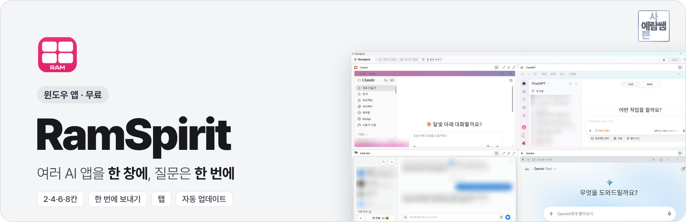

  <a href="https://github.com/dpfkadpfka/ramspirit/releases/latest/download/RamSpirit.exe"><b>RamSpirit.exe 내려받기</b></a>
  &nbsp;·&nbsp; <a href="https://github.com/dpfkadpfka/ramspirit/releases/latest">최신 버전</a>
  &nbsp;·&nbsp; <a href="CHANGELOG.md">바뀐 점</a>
  &nbsp;·&nbsp; 윈도우 10·11 · 무료

**RamSpirit**는 Claude · ChatGPT · Gemini · Grok 같은 AI 앱과 내 컴퓨터의 프로그램을 한 창에 2·4·6·8칸으로 나눠 띄우는 윈도우 앱이에요. 아래 입력창에 한 번 쓰면 여러 칸에 같은 질문이 한꺼번에 들어가요.

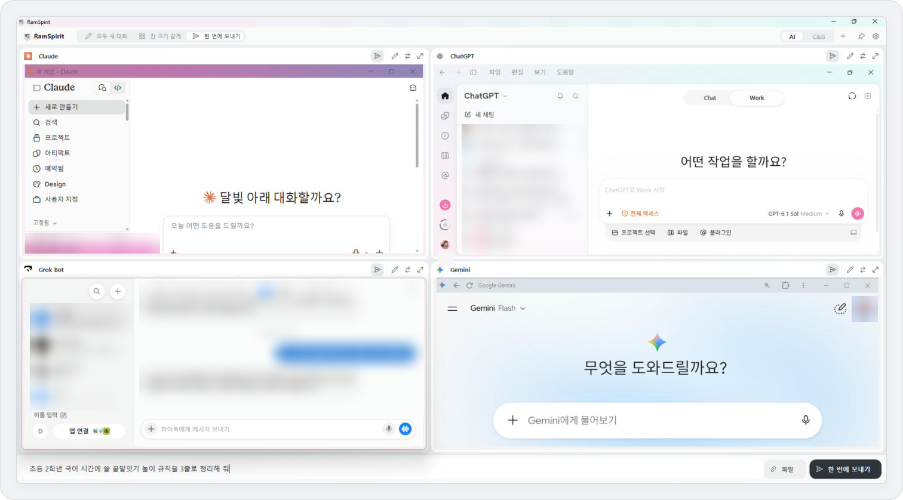

실제 실행 화면 (4칸) · 개인 대화 목록은 흐리게 가렸어요

## 목차

1. [주요 기능](#주요-기능)
2. [화면 둘러보기](#화면-둘러보기)
3. [설치하기](#설치하기)
4. [처음 설정](#처음-설정)
5. [설정 한눈에](#설정-한눈에)
6. [업데이트](#업데이트)
7. [자주 묻는 질문](#자주-묻는-질문)
8. [바뀐 점](#바뀐-점)

---

## 주요 기능

### 한 번에 보내기

아래 입력창에 쓰고 <kbd>Enter</kbd>를 누르면 종이비행기가 켜진 칸 모두에 같은 질문이 들어가요. 파일도 함께 보낼 수 있어요.

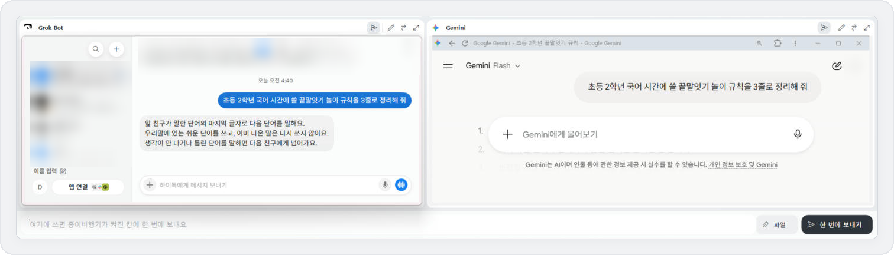

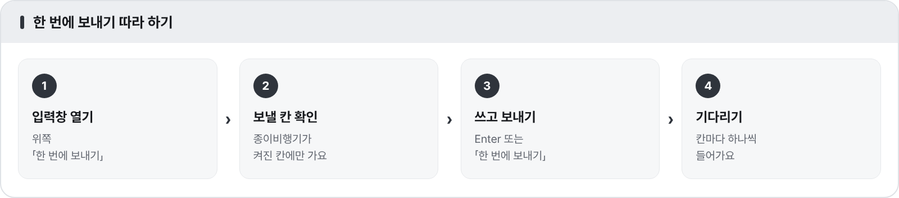

| 설정 | 보내기 | 줄바꿈 |
|---|---|---|
| 기본 | <kbd>Enter</kbd> | <kbd>Shift</kbd>+<kbd>Enter</kbd> |
| 「Ctrl+Enter로 보내기」 켬 | <kbd>Ctrl</kbd>+<kbd>Enter</kbd> | <kbd>Enter</kbd> |

> [!TIP]
> 파일은 입력창 오른쪽 「파일」 버튼을 누르거나, 탐색기에서 입력창 위로 끌어다 놓으면 들어가요.

### 칸마다 보내기 켜고 끄기

칸 오른쪽 위 종이비행기를 누르면 그 칸만 빼고 보낼 수 있어요. 꺼진 칸은 아이콘에 사선이 그어져요.

### 칸 크기 조절

칸 사이 선을 잡고 끌면 안내선만 움직이고, 놓는 순간 칸 크기가 바뀌어요. 위쪽 「칸 크기 같게」를 누르면 다시 똑같아져요.

| 끄는 중 | 놓은 뒤 |
|---|---|
| 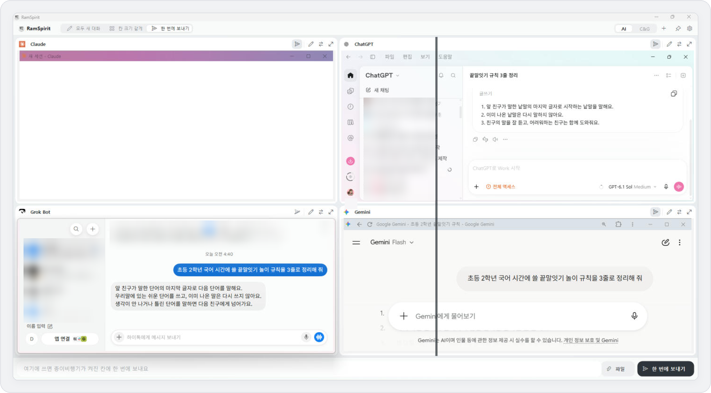 | 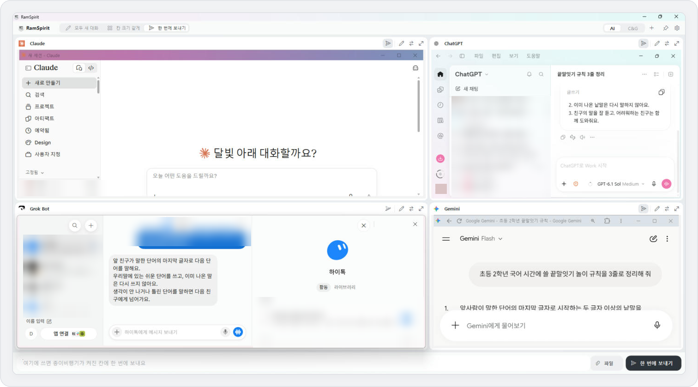 |

### 한 칸만 크게 보기

칸 오른쪽 위 네 모서리 화살표를 누르면 그 칸만 창 가득 보여요. 다시 누르거나 왼쪽 위 「RamSpirit」를 누르면 돌아와요.

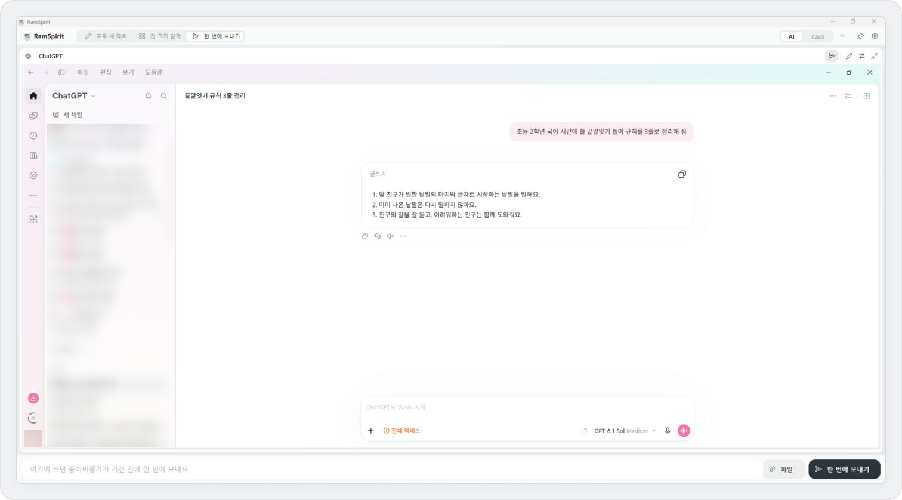

### 앱 바꾸기

칸 오른쪽 위 화살표 두 개를 누르면 다른 AI나 내 컴퓨터에 설치된 프로그램(포토샵·한글 등)으로 바꿀 수 있어요. 사이트 주소를 직접 넣을 수도 있어요.

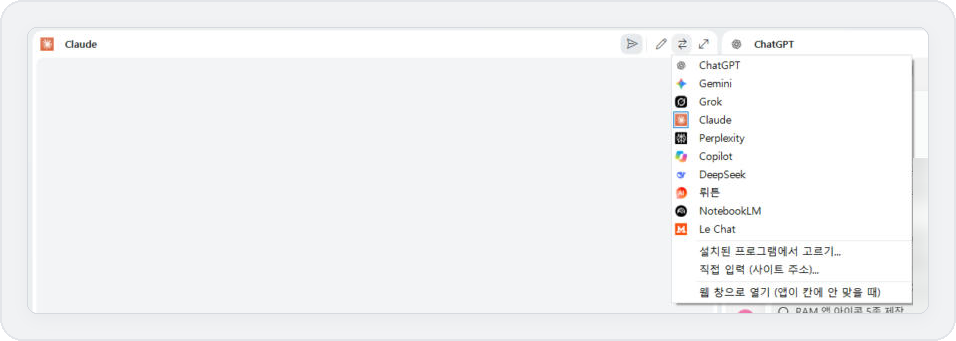

> [!NOTE]
> 컴퓨터에 설치된 앱이 있으면 앱으로, 없으면 웹 창으로 열어요. 앱이 칸에 잘 안 맞으면 메뉴 맨 아래 「웹 창으로 열기」를 고르세요.

### 탭

「AI」 탭, 「이미지」 탭처럼 칸 구성을 여러 개 두고 바꿔 가며 쓸 수 있어요. 탭을 끌면 순서가 바뀌고, 오른쪽 클릭하면 이름 바꾸기·칸 고르기·지우기 메뉴가 나와요.

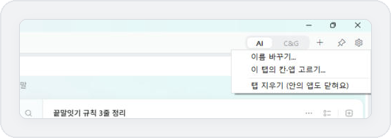

### 앱 아이콘 고르기

설정 → 화면 → **앱 아이콘**에서 7가지 중 마음에 드는 아이콘을 고를 수 있어요. 창 · 작업 표시줄 · 알림 영역 · 바탕화면 바로가기 아이콘이 함께 바뀌어요.

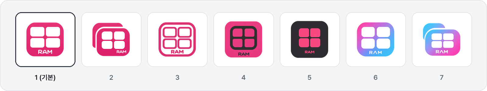

### 켤 때 자동으로 칸에 넣기

켜면 칸마다 정해 둔 앱을 찾아서 넣어요. 앱이 칸에 들어가는 동안에는 로딩 화면이 보여요.

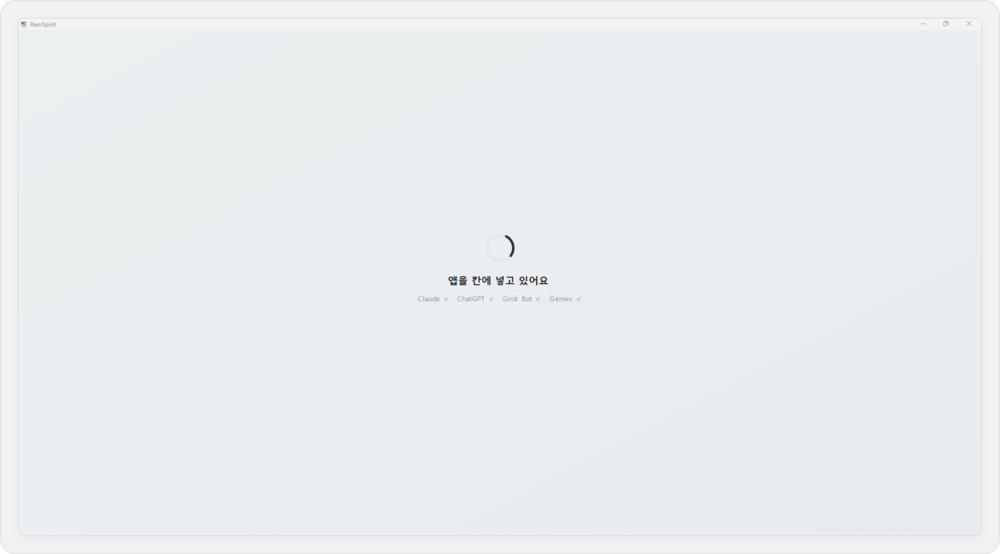

---

## 화면 둘러보기

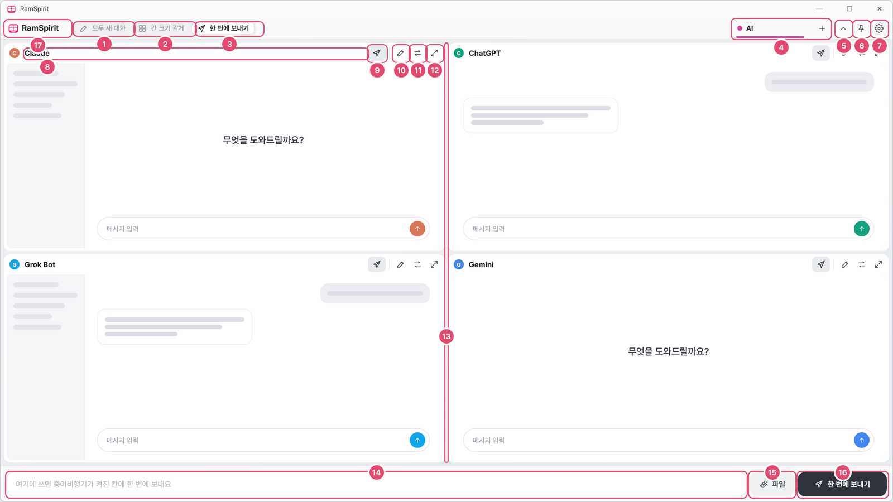

| # | 이름 | 하는 일 | # | 이름 | 하는 일 |
|---|---|---|---|---|---|
| 1 | RamSpirit | 크게 보기에서 칸 나누기로 돌아가기 | 9 | 종이비행기 | 이 칸에도 보낼지 켬/끔 |
| 2 | 모두 새 대화 | 보이는 칸을 모두 새 대화로 | 10 | 연필 | 이 칸만 새 대화 |
| 3 | 칸 크기 같게 | 칸 크기를 똑같이 되돌리기 | 11 | 화살표 두 개 | 이 칸의 앱 바꾸기 |
| 4 | 한 번에 보내기 | 아래 입력창 열기·닫기 | 12 | 네 모서리 화살표 | 이 칸만 크게 보기 |
| 5 | 탭 | 칸 구성 바꾸기 · 끌어서 순서 바꾸기 | 13 | 칸 사이 선 | 끌어서 칸 크기 조절 |
| 6 | ＋ | 새 탭 만들기 | 14 | 입력창 | 여러 칸에 보낼 글 쓰기 |
| 7 | 핀 | 항상 위에 두기 | 15 | 파일 | 함께 보낼 파일 넣기 |
| 8 | 톱니 | 설정 | 16 | 한 번에 보내기 | 켜 둔 칸에 보내기 |

> [!TIP]
> 아이콘에 마우스를 올리면 하는 일이 위쪽에 짧게 나와요.

---

## 설치하기

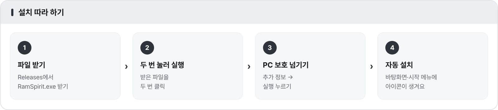

1. [**RamSpirit.exe 내려받기**](https://github.com/dpfkadpfka/ramspirit/releases/latest/download/RamSpirit.exe)를 눌러 파일을 받아요.
2. 받은 파일을 두 번 눌러 실행해요.
3. 파란 **「Windows의 PC 보호」** 창이 뜨면 **추가 정보**를 누르고 **실행**을 눌러요.
4. RamSpirit가 스스로 제자리에 설치되고, 바탕화면과 시작 메뉴에 아이콘이 생겨요. 받은 파일은 지워도 돼요.

<!-- SMARTSCREEN -->

> [!WARNING]
> 「Windows의 PC 보호」는 개인이 만든 앱이라 나오는 안내예요. 처음 한 번만 「추가 정보 → 실행」을 누르면 다음부터는 뜨지 않아요.

---

## 처음 설정

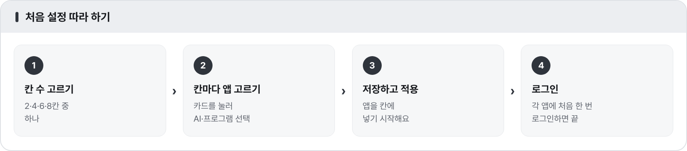

처음 켜면 설정 창이 열려요. 칸 수를 고르고, 카드를 눌러 칸마다 열 앱을 고른 뒤 **저장하고 적용**을 누르면 끝이에요. 나중에 바꾸려면 위쪽 톱니(설정)를 누르세요.

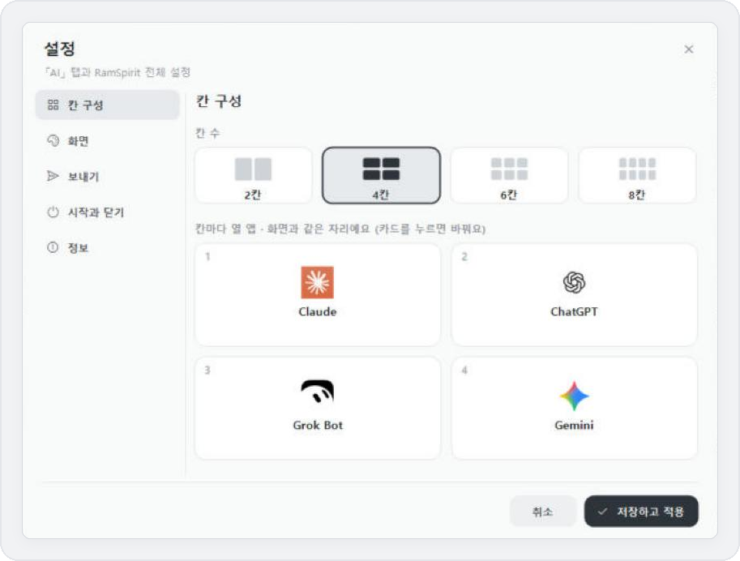

> [!TIP]
> 각 AI 앱에는 처음 한 번만 로그인하면 돼요. RamSpirit는 앱을 칸에 넣어 보여 줄 뿐, 로그인 정보는 건드리지 않아요.

---

## 설정 한눈에

| 화면 | 보내기 |
|---|---|
| 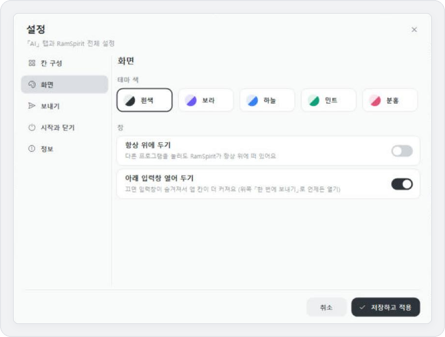 | 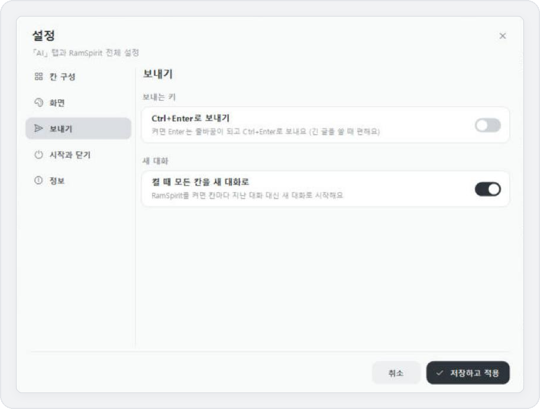 |
| 테마 색 5가지 · 항상 위에 두기 · 아래 입력창 열어 두기 · 앱 아이콘 7가지 | Ctrl+Enter로 보내기 · 켤 때 모든 칸을 새 대화로 |
| **시작과 닫기** | **정보** |
| 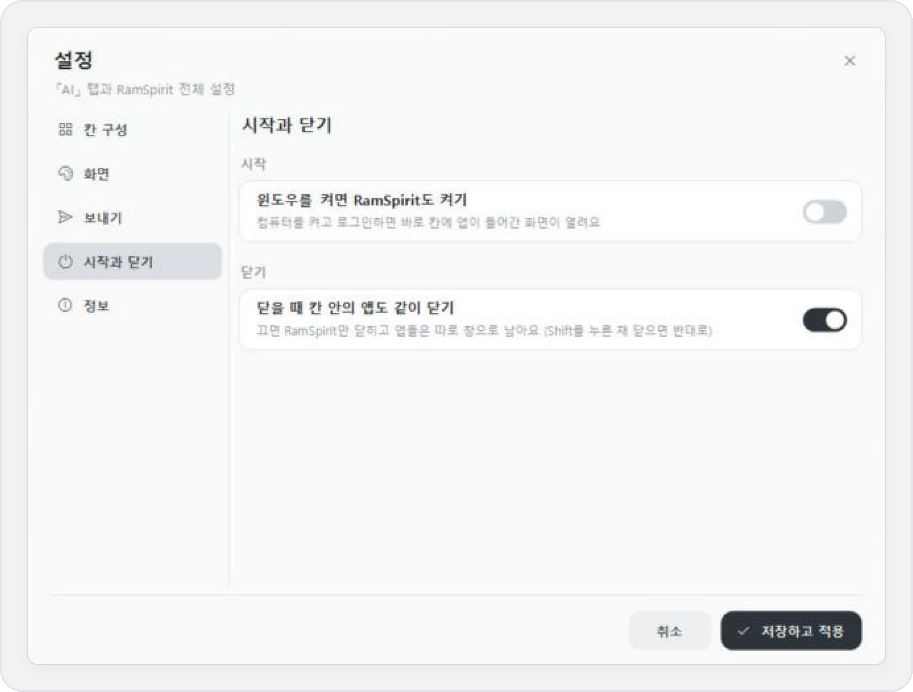 | 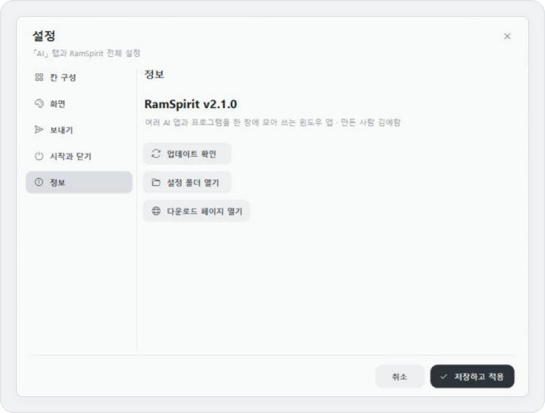 |
| 윈도우를 켜면 RamSpirit도 켜기 · 닫을 때 칸 안의 앱도 같이 닫기 | 지금 버전 · 업데이트 확인 · 설정 폴더 · 다운로드 페이지 |

---

## 업데이트

새 버전이 나오면 RamSpirit를 켠 뒤 알아서 받아 둬요. 다 받으면 위쪽에 **「새 버전 준비됨 · 다시 시작」** 버튼이 나타나고, 누르면 다시 켜지면서 적용돼요.

직접 확인하려면 작업 표시줄의 RamSpirit 아이콘을 오른쪽 클릭 → **업데이트 확인**, 또는 설정 → 정보 → **업데이트 확인**을 누르세요.

---

## 자주 묻는 질문

<b>어떤 칸에는 메시지가 안 들어가요</b>

그 칸의 종이비행기가 켜져 있는지 보세요. 켜져 있는데도 안 들어가면 그 칸을 누르고 <kbd>Ctrl</kbd>+<kbd>V</kbd>로 붙여 넣으세요. 보낸 글이 복사돼 있어요.

<b>「모두 새 대화」가 어떤 앱에서는 안 돼요</b>

앱이 업데이트되면서 「새 채팅」 버튼 이름이 바뀌면 찾지 못할 수 있어요. 그때는 그 앱에서 직접 새 채팅을 눌러 주세요.

<b>칸 크기가 한쪽으로 쏠렸어요</b>

위쪽 「칸 크기 같게」를 누르세요. 그래도 한 칸이 크면 그 앱이 더 작아지지 않는 경우예요. 「앱 바꾸기」에서 **웹 창으로 열기**를 고르세요.

<b>창을 작게 줄였더니 앱이 안 보여요</b>

앱이 칸보다 커서 창 밖으로 튀어나오지 않도록 잠시 숨긴 거예요. 창을 키우면 다시 나타나고, 칸을 누르면 그 칸만 크게 볼 수 있어요.

<b>칸 안의 앱이 닫혔어요</b>

칸 가운데 「여기를 누르면 다시 열어요」를 누르세요.

<b>여러 탭에 같은 앱을 넣어도 되나요?</b>

돼요. Claude·ChatGPT처럼 창이 하나뿐인 앱은 지금 보고 있는 탭으로 옮겨 오고, 다른 탭 칸에는 「○○ 탭에서 쓰는 중이에요」라고 나와요. 그 탭으로 돌아가면 다시 그쪽으로 가요.

<b>아이콘을 눌러도 새 창이 안 떠요</b>

RamSpirit는 한 번에 하나만 켜져요. 이미 켜져 있으면 그 창이 앞으로 와요.

<b>켜다가 오류가 났다고 나와요</b>

다시 켜 보시고, 계속 그러면 설정 → 정보 → 설정 폴더 열기에서 <code>error.log</code> 파일을 보내 주세요.

<b>지우고 싶어요</b>

RamSpirit를 닫고, 탐색기 주소창에 <code>%LOCALAPPDATA%\RamSpirit</code>를 넣어 나온 폴더와 바탕화면·시작 메뉴 바로가기를 지우세요. 설정까지 지우려면 <code>%APPDATA%\RamSpirit</code>도 지우면 돼요.

---

## 바뀐 점

버전마다 바뀐 점은 [**CHANGELOG.md**](CHANGELOG.md)와 [**Releases**](https://github.com/dpfkadpfka/ramspirit/releases)에서 볼 수 있어요.

---

만든 사람 김예람 · RamSpirit는 각 AI 서비스와 관계없는 개인 프로젝트예요

